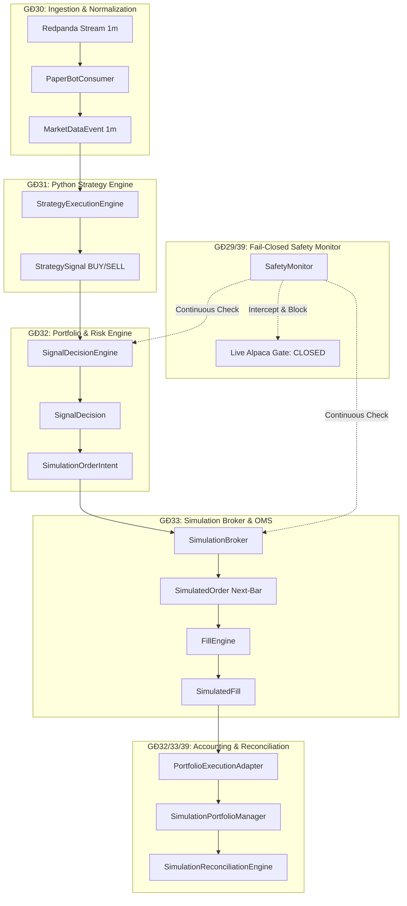

# GĐ39 — RELIABILITY ARCHITECTURE

**Dự án:** AlgoTrading V2.0  
**Giai đoạn:** GĐ39 — END-TO-END INTEGRATION, SHORT SOAK & RELIABILITY VERIFICATION  
**Môi trường:** SIMULATION ONLY  
**Trading Mode:** DRY_RUN  
**PaperExecutionGate:** CLOSED (`is_gate_open = False`)  

---

## 1. Tổng quan Kiến trúc Độ tin cậy (Reliability Architecture)

Giai đoạn GĐ39 thiết lập bộ khung kiểm chứng độ tin cậy và tích hợp tổng thể (End-to-End Reliability Harness) cho toàn bộ hệ thống Paper Trading Bot V2.0 kế thừa từ GĐ29 đến GĐ38.

---

## 2. Các Trụ cột Độ tin cậy (Reliability Pillars)

### A. Fail-Closed Safety Gate & Invariant Protection
- **Giám sát liên tục (Continuous Invariant Monitoring):** `SafetyMonitor` xác thực mọi chu kỳ xử lý rằng `TRADING_MODE == 'DRY_RUN'` và `PaperExecutionGate.is_gate_open == False`.
- **Zero Outbound Broker Writes:** Mọi nỗ lực phát lệnh ra ngoài broker thực (Alpaca Paper / Live) đều bị chặn ngay lập tức và kích hoạt `CriticalSafetyViolationError`.
- **Natural Market Data Protection:** Không cho phép ghi đè, làm ô nhiễm dữ liệu thị trường tự nhiên hoặc các topic streaming tự nhiên.

### B. Cân bằng Hạch toán Tài chính (Simulation Balance Equation)
Đẳng thức kế toán được kiểm toán tự động sau mỗi fill và định kỳ trong suốt quá trình chạy soak:
$$\text{Cash} + \text{Cost Basis of Open Positions} + \text{Reserved Cash} = \text{Initial Cash} + \text{Realized PnL} - \text{Total Fees}$$
- Bất kỳ sai lệch nào vượt ngưỡng dung sai $\epsilon = 10^{-4}$ USD đều kích hoạt cảnh báo `CASH_MISMATCH`.
- Đảm bảo tính toán khớp lệnh 100% không sinh ra tiền ảo hoặc thất thoát phí/trượt giá.

### C. Cách ly Đa Bot (Multi-Bot Sandbox Isolation)
- Mỗi Bot sở hữu không gian trạng thái độc lập tuyệt đối: `PortfolioManager`, `RiskEngine`, `OrderStore`, `FillStore`, `AuditJournal`.
- Chia sẻ luồng Market Data qua `V2MarketDataDispatcher` theo cơ chế broadcast fan-out mà không chia sẻ trạng thái giao dịch.
- Lỗi nghiêm trọng tại một Bot (Crash, Exception, Gap Blocked) được cô lập hoàn toàn, không gây ảnh hưởng đến các Bot khác đang chạy song song.

### D. Khắc phục Thất thoát Dữ liệu (Queue Overflow & Gap Recovery)
- Cơ chế phát hiện tràn hàng đợi cục bộ: khi hàng đợi của Bot vượt ngưỡng `max_queue_size`, Bot chuyển sang trạng thái an toàn `DATA_GAP_BLOCKED`.
- Quá trình khôi phục: Dispatcher giữ lại các sự kiện chưa xử lý, sắp xếp theo trình tự thời gian tuyệt đối (temporal order), replay tuần tự cho Bot và đưa Bot quay lại trạng thái `RUNNING` một cách an toàn.

### E. Kiểm soát Điểm dừng & Phục hồi sau Sự cố (Checkpoint & Crash Recovery)
- Động cơ bơm lỗi có kiểm soát (`FaultInjectionEngine`) hỗ trợ can thiệp tại 8 điểm then chốt:
  1. `AFTER_BAR_RECEIVE`
  2. `AFTER_SIGNAL_GENERATE`
  3. `AFTER_INTENT_GENERATE`
  4. `AFTER_ORDER_CREATE`
  5. `AFTER_FILL_SIMULATE`
  6. `AFTER_TRANSACTION_APPLY`
  7. `BEFORE_CHECKPOINT`
  8. `AFTER_CHECKPOINT_BEFORE_COMMIT`
- Khôi phục trạng thái từ Checkpoint nguyên tử bảo đảm không trùng lặp fill (Zero Duplicate Fills) và không sai lệch sổ lệnh (Zero Duplicate Transactions).
