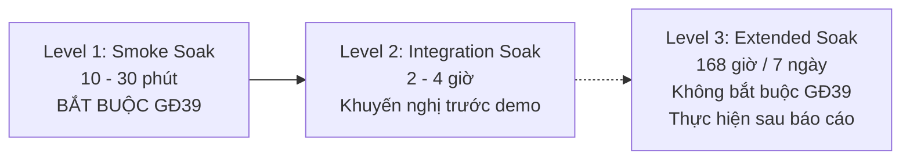

# GĐ39 — SHORT SOAK VERIFICATION PLAN

**Dự án:** AlgoTrading V2.0  
**Giai đoạn:** GĐ39 — End-to-End Integration, Short Soak & Reliability Verification  
**Môi trường:** SIMULATION ONLY  
**Trading Mode:** DRY_RUN  

---

## 1. Bối cảnh & Mục đích

Thực hiện kiểm thử ngâm ngắn (Short Soak) có thời lượng thực tế dựa trên đồng hồ thời gian thực (wall-clock time) để xác minh độ ổn định vận hành của AlgoTrading V2.0 trước thềm báo cáo nghiệm thu vào **Thứ Bảy, 28/11/2026**.

Kiểm thử ngâm ngắn được cấu trúc thành 3 cấp độ:

> [!IMPORTANT]
> **Quy định Rõ ràng về Phạm vi GĐ39:**
> GĐ39 **KHÔNG** yêu cầu phải hoàn thành 168 giờ liên tục trước khi nghiệm thu. Cấp độ 1 (Smoke Soak) và Cấp độ 2 (Integration Soak) là đủ điều kiện tiên quyết để nghiệm thu giai đoạn GĐ39 và sẵn sàng demo vào Thứ Bảy, 28/11/2026. Cấp độ 3 (168 giờ) được chuyển giao sang giai đoạn vận hành dài hạn sau nghiệm thu.

---

## 2. Kế hoạch Kiểm thử Chi tiết

### A. Cấu hình Vận hành
- **Số lượng Bot Đồng thời:** 3 Bot độc lập:
  1. `soak_bot_alpha`: Chiến lược `MA_CROSS_1M`, mã giao dịch `NVDA`, vốn mô phỏng 100,000 USD.
  2. `soak_bot_beta`: Chiến lược `RSI_1M`, mã giao dịch `NVDA`, vốn mô phỏng 150,000 USD.
  3. `soak_bot_gamma`: Chiến lược `MA_CROSS_1M`, mã giao dịch `BTC/USD`, vốn mô phỏng 200,000 USD.
- **Tần suất Nến:** 1 nến mô phỏng mỗi 200ms – 500ms wall-clock time.
- **Giám sát Nhịp tim (Heartbeat):** Ghi nhận nhịp tim của từng Bot sau mỗi lần xử lý nến.

### B. Bộ Tiêu chí Đánh giá Pass/Fail Khắt khe
1. **Bất biến Tuyệt đối (Hard Invariants — Không khoan nhượng):**
   - Số cuộc gọi ghi ra broker ngoài: **Chính xác bằng 0**.
   - Số cuộc gọi giao dịch live: **Chính xác bằng 0**.
   - Số giao dịch tài chính trùng lặp: **Chính xác bằng 0**.
   - Ô nhiễm topic dữ liệu thị trường tự nhiên: **Chính xác bằng 0**.
   - Vi phạm an toàn nghiêm trọng: **Chính xác bằng 0**.
   - Cân bằng tài chính sau khi kết thúc soak: **100% BALANCED**.
2. **Ngưỡng Vận hành (Soft Thresholds):**
   - Độ trễ p95 E2E: $\le 100.0$ ms.
   - Độ trễ p99 E2E: $\le 250.0$ ms.
   - Khoảng hở dữ liệu không phục hồi được: 0.
