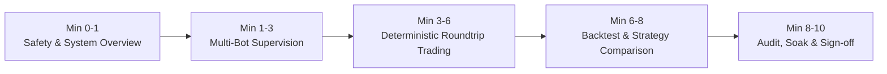

# GĐ40 — AlgoTrading V2.0 Demonstration Script (Saturday, 28/11/2026)

## 1. Demonstration Metadata & Objectives

- **Target Presentation Date**: Saturday, 28/11/2026
- **Audience**: Technical Stakeholders, Project Leadership, Risk & Quant Reviewers
- **Target Duration**: 8 to 10 minutes
- **Environment**: Local Windows Workstation (`D:\AlgoTrading`)
- **Mode**: `SIMULATION` / `DRY_RUN` / `PaperExecutionGate=CLOSED`
- **Primary Goal**: Prove that AlgoTrading V2.0 has successfully unified GĐ29 through GĐ39 into a stable, verifiable, and visually intuitive simulation platform capable of complete order lifecycles, deterministic backtesting, multi-bot isolation, and zero-cash-discrepancy portfolio accounting.

---

## 2. Minute-by-Minute Presentation Timeline

---

### Phase 1: Context, Invariants & Safety Verification (Min 0:00 – 1:30)

1. **Speaker Dialogue**:
   > *"Good morning everyone. Today we are presenting AlgoTrading V2.0 Simulation Release Candidate 1 (`v2.0.0-rc1`). Over the last 11 engineering stages (GĐ29 to GĐ39), our objective has been to build an independent, institutional-grade algorithmic trading simulation engine.*
   > *Before we look at the UI, let's verify our strict safety boundaries: `TRADING_MODE` is locked to `DRY_RUN`, our `PaperExecutionGate` is CLOSED with exactly 0 broker write calls, and our entire execution pipeline operates in an isolated virtual sandbox. There is zero risk of capital loss or unintended execution."*

2. **Actions to Demonstrate**:
   - Open terminal or visual badge on Dashboard header: Show **Mode: DRY_RUN** and **Paper Gate: CLOSED**.
   - Show `data/status/gd40_safety_evidence.json` showing all 11 safety invariants passing.

---

### Phase 2: Multi-Bot Overview & Sandbox Isolation (Min 1:30 – 3:30)

1. **Speaker Dialogue**:
   > *"Let's open our React 19 Trading Dashboard at localhost:5173. We'll start at the Multi-Bot Overview tab. Here, our MultiBotSupervisor manages distinct bot instances concurrently, each isolated in its own sandbox with independent capital, position book, and strategy configuration."*

2. **Actions to Demonstrate**:
   - Navigate to **Multi-Bot Overview**.
   - Highlight 3 running demo bots:
     - `demo_bot_alpha`: Symbol NVDA, Initial Cash \$100,000, Strategy `MA_CROSS_1M`.
     - `demo_bot_beta`: Symbol BTC/USD, Initial Cash \$150,000, Strategy `RSI_1M`.
     - `demo_bot_gamma`: Symbol ETH/USD, Initial Cash \$200,000, Strategy `MEAN_REVERSION_1M`.
   - Click **Pause** on `demo_bot_alpha`:
     - Show `demo_bot_alpha` transition to `PAUSED`.
     - Show `demo_bot_beta` and `demo_bot_gamma` continue in `RUNNING` state without any interruption.
   - Click **Resume** on `demo_bot_alpha`:
     - Bot transitions smoothly back to `RUNNING`.

---

### Phase 3: Deterministic Roundtrip Trading & Balanced Accounting (Min 3:30 – 6:00)

1. **Speaker Dialogue**:
   > *"Now let's examine the heart of the engine: end-to-end signal generation, order execution, and double-entry portfolio accounting. We will inspect a complete roundtrip trade on NVDA."*

2. **Actions to Demonstrate**:
   - Navigate to **Orders & Fills** tab (or run `python scripts/verify_gd40_deterministic_roundtrip.py` live in terminal):
   - **Step 1: Signal & Intent**: At Bar 60, SMA-9 crosses above SMA-21 (Golden Cross). The Strategy Engine generates a `BUY` signal. Risk Engine allocates 2% equity $\rightarrow$ `SimulationOrderIntent` created for 16 shares.
   - **Step 2: Simulated Fill**: At Bar 61 open, order fills at \$135.0675 (incorporating 5 bps slippage + \$1.50 commission).
   - **Step 3: Position Tracking**: Position book updates with 16 NVDA, cost basis \$2,161.08.
   - **Step 4: Exit Signal**: At Bar 70, Death Cross occurs $\rightarrow$ `SELL` signal generated for 16 shares.
   - **Step 5: Exit Fill**: At Bar 71 open, order fills at \$74.9625 (incorporating 5 bps slippage + \$1.50 commission).
   - **Step 6: Mathematical Reconciliation**:
     - Initial Cash: \$100,000.00
     - Final Cash: \$99,035.32
     - Gross Realized P&L: -\$961.68
     - Total Fees: \$3.00
     - Net Trading P&L: -\$964.68
     - Discrepancy: **\$0.0000** (Accounting Check: `BALANCED`).

---

### Phase 4: Backtesting Engine & Strategy Comparison (Min 6:00 – 8:00)

1. **Speaker Dialogue**:
   > *"Next, let's look at the GĐ36 & GĐ38 Backtesting subsystem. We can replay identical market conditions across different strategy presets and compare performance metrics with full reproducibility."*

2. **Actions to Demonstrate**:
   - Navigate to **Backtesting Workbench**.
   - Show Backtest Run for **Variant A (MA Crossover)** vs **Variant B (RSI Strategy)** on NVDA 1m bars.
   - Point out key metrics: Total Return, Sharpe Ratio, Sortino Ratio, Max Drawdown.
   - Show the **Deterministic Fingerprint**: `4f53cda18c2baa0c...` (64-character SHA-256 hash). Re-running the backtest on the same dataset yields the exact same hash, proving 100% determinism.
   - Navigate to **Backtest Comparison** tab: Display side-by-side comparison matrix and robustness evaluation.

---

### Phase 5: Regression Baseline, Soak Evidence & Sign-Off (Min 8:00 – 10:00)

1. **Speaker Dialogue**:
   > *"To conclude, we review our quality and reliability metrics. Our complete automated test suite across all 11 modules stands at 623 passing tests out of 623 (100.0% pass rate). In GĐ39, we proved system stability with a 30-second Harness Smoke and a 600-second (10-minute) Level 1 Smoke Soak with 3,000 events and 0 errors.*
   > *Because the 2-hour Level 2 Integration Soak remains pending before any future live or Alpaca paper release, our formal verdict for today is `CONDITIONALLY_READY_FOR_DEMO`. The system is fully ready for operational review and user evaluation."*

2. **Actions to Demonstrate**:
   - Show terminal test run summary: `623 passed in 12.365s`.
   - Open `data/status/gd40_acceptance.json` displaying the formal verdict and audit trail.
   - Open floor for Stakeholder Q&A.
