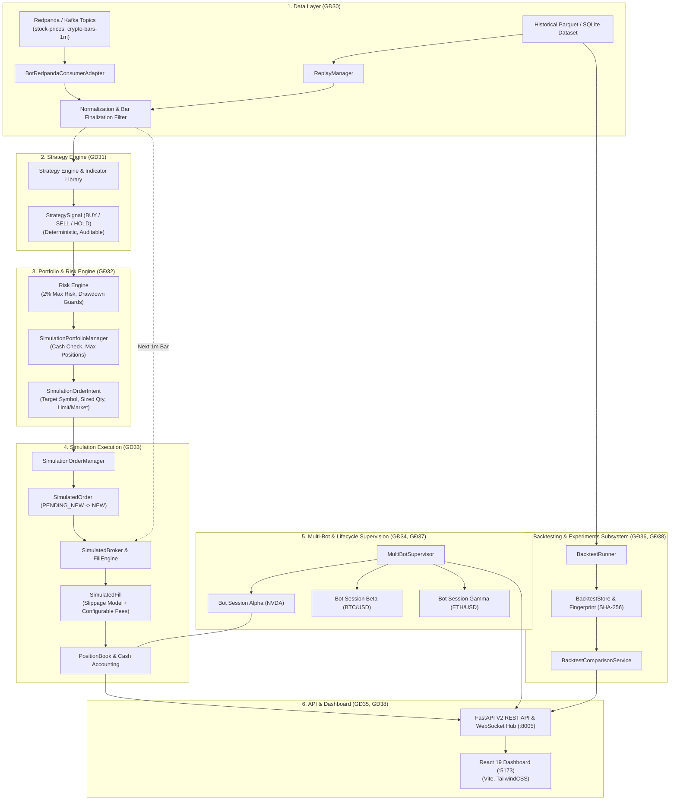
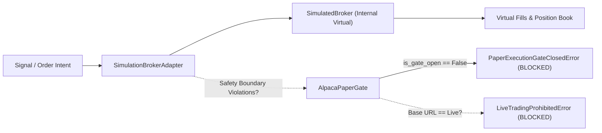

# GĐ40 — AlgoTrading V2.0 System Architecture Specification

## 1. Architectural Overview & Design Philosophy

AlgoTrading V2.0 is designed as a **modular, event-driven, fail-closed algorithmic trading simulation architecture**. It builds on top of the battle-tested market data layer of V1 while decoupling strategy calculation, portfolio accounting, risk management, and order execution into an isolated simulation sandbox.

The architecture strictly adheres to three fundamental engineering principles:
1. **Unidirectional Data Flow**: Market data flows deterministically through ingestion, indicator calculation, strategy signal generation, risk screening, and execution simulation without cyclic dependencies.
2. **Fail-Closed Safety**: Any unexpected state, invalid price, risk violation, or external broker call immediately halts execution or raises explicit domain exceptions.
3. **Double-Entry Accounting Invariance**: Portfolio cash and positions are governed by the strict invariant:
   $$\text{Cash} + \text{Cost Basis} = \text{Initial Cash} + \text{Gross Realized P&L} - \text{Total Fees}$$
   ensuring exact mathematical reconciliation after every simulated fill.

---

## 2. End-to-End System Pipeline

---

## 3. Subsystem Breakdown & Stage Traceability

### 3.1 GĐ30 — Redpanda Market Data & Ingestion Layer
- **Responsibility**: Ingest 1-minute OHLCV bars from Redpanda topics (`stock-prices`, `crypto-bars-1m`) or historical dataset stores.
- **Normalization Engine**: Validates timestamp ordering, filters out incomplete/unfinalized bars, and enforces schema compliance (`MarketDataEvent`).
- **Data Gap & Replay Recovery**: Tracks consumer offsets and bar continuity, buffering late bars and signaling gaps to the supervisor.

### 3.2 GĐ31 — Strategy Engine & Indicator Library
- **Responsibility**: Compute technical indicators and generate trading signals deterministically.
- **Indicator Suite**: SMA, EMA, RSI, MACD, ATR, Bollinger Bands.
- **Contract**: Strategies implement `TradingStrategy.on_bar(event: MarketDataEvent) -> StrategySignal`. Strategies maintain internal state cleanly and support stateless re-computation on historical replay.

### 3.3 GĐ32 — Portfolio & Risk Management Engine
- **Responsibility**: Evaluates `StrategySignal` against capital constraints, position limits, and risk parameters.
- **Position Sizing**: Enforces fixed fractional risk (default: 2% of equity per trade) based on stop loss distance or ATR.
- **Risk Screening**: Rejects signals if open position limit is reached, cash is insufficient, or daily/trailing drawdown thresholds are breached.
- **Output**: Generates immutable `SimulationOrderIntent`.

### 3.4 GĐ33 — Order Management & Simulation Broker Engine
- **Responsibility**: Manages order lifecycles and simulates order fills on subsequent 1-minute market bars.
- **Lifecycle States**: `PENDING_NEW` $\rightarrow$ `NEW` $\rightarrow$ `PARTIALLY_FILLED` $\rightarrow$ `FILLED` / `CANCELED` / `REJECTED`.
- **Fill Models**:
  - **Slippage**: Fixed basis points (default: 5 bps) or volume-weighted slippage.
  - **Fees**: Flat per-order fee (e.g., \$1.50) + basis point transaction fee.
- **Accounting Verification**: Position cost basis and cash balances are updated atomically upon fill event dispatch.

### 3.5 GĐ34 & GĐ37 — Bot Lifecycle Controller & Multi-Bot Supervisor
- **Responsibility**: Orchestrates the event loop and manages concurrent bot sandboxes.
- **Lifecycle State Machine**: `STARTING` $\rightarrow$ `RUNNING` $\rightleftharpoons$ `PAUSED` $\rightarrow$ `STOPPING` $\rightarrow$ `STOPPED` (or `ERROR`).
- **Resource & State Isolation**: Each bot instance possesses private instances of `PositionBook`, `RiskEngine`, `StrategyEngine`, and `OrderManager`. Market data is broadcast to subscribed bots via non-blocking fan-out queues.

### 3.6 GĐ35 & GĐ38 — REST API, WebSockets & Configuration Presets
- **FastAPI Endpoints**: Full CRUD and control endpoints under `/api/v2/bots`, `/api/v2/backtests`, `/api/v2/experiments`, `/api/v2/strategies`.
- **WebSocket Gateway**: High-throughput telemetry broadcasting portfolio snapshots, order events, and system health.
- **Strategy Presets**: Immutable JSON configurations tagged with cryptographic SHA-256 parameter hashes.

### 3.7 GĐ36 — Backtesting & Deterministic Replay Engine
- **Responsibility**: Executes full simulation pipeline across historical time-series data with microsecond timestamp fidelity.
- **Parity**: Employs identical strategy, risk, order, and fill classes as live simulation bots.
- **Reproducibility Fingerprint**: Every backtest produces a deterministic 64-character hex hash of inputs, fills, and final equity.

---

## 4. Safety Guardrails & Alpaca Paper Gate

The system guarantees that zero network packets are sent to Alpaca order execution endpoints. All simulated execution is completely enclosed within local memory and local SQLite stores.
