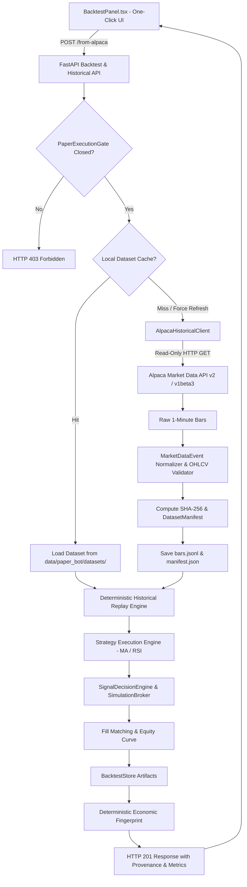

# GĐ41 — REAL ALPACA HISTORICAL DATA & ONE-CLICK BACKTEST INTEGRATION

## 1. Executive Summary
- **Milestone**: GĐ41 — Real Alpaca Historical Market Data & One-Click Backtest Integration
- **Project**: AlgoTrading V2.0 Quantitative Trading Platform
- **Baseline Version**: v2.0.0-rc1
- **Operational Sandbox**: `SIMULATION ONLY`, `TRADING_MODE=DRY_RUN`, `PaperExecutionGate.is_gate_open=False`
- **Core Capability**: Eliminates manual CSV uploads by enabling one-click historical OHLCV data retrieval from Alpaca Market Data API (Equities & Crypto 24/7) directly inside the V2 Backtest Dashboard, with automatic validation, SHA-256 dataset manifests, local cache persistence, and strict anti-lookahead backtest simulation.

---

## 2. Architectural Design

---

## 3. Key Components Implemented

### 3.1 Read-Only Alpaca Historical Client (`libs/bot/backtesting/alpaca_client.py`)
- **Stock Historical Client**: `alpaca.data.historical.StockHistoricalDataClient` for US Equities (IEX / SIP feeds).
- **Crypto Historical Client**: `alpaca.data.historical.CryptoHistoricalDataClient` for 24/7 digital assets (`BTC/USD`, `ETH/USD`, `SOL/USD`).
- **Resilience**:
  - Multi-page pagination support using Alpaca `page_token`.
  - HTTP 429 rate-limit backoff with exponential multiplier and randomized jitter.
  - Timeout and finite retries (max 4 attempts) for transient network drops.
  - Explicit error handling: never masks 401/403 credentials errors, never silently falls back to synthetic data.

### 3.2 Dataset Cache & Manifest Manager (`libs/bot/backtesting/dataset.py`)
- **SHA-256 Immutability**: Hashes canonical bar lines `symbol:event_time:open:high:low:close:volume:bar_revision`.
- **Manifest Fields**: Captures provider (`ALPACA`), source type (`REAL_HISTORICAL_MARKET_DATA`), feed (`IEX`/`SIP`/`CRYPTO`), asset class, requested and actual date ranges, duplicate counts, and gap statistics.
- **Cache Lookup**: `find_cached_dataset(symbol, timeframe, feed, start_time, end_time)` prevents duplicate API hits.
- **CSV Export**: `export_csv(dataset_id)` allows instant export to standard OHLCV CSV format.

### 3.3 REST API Endpoints (`libs/bot/api/historical_routes.py` & `backtest_routes.py`)
- `POST /api/v2/historical-data/fetch`: Fetch, validate, hash, and persist dataset from Alpaca.
- `GET /api/v2/historical-data/datasets`: List all cached and uploaded historical datasets.
- `GET /api/v2/historical-data/datasets/{dataset_id}`: Inspect manifest, checksum, and provenance.
- `GET /api/v2/historical-data/datasets/{dataset_id}/bars`: Paginated inspection of actual bars.
- `GET /api/v2/historical-data/datasets/{dataset_id}/csv`: Download dataset as CSV.
- `POST /api/v2/backtests/from-alpaca`: One-click fetch + validate + cache + backtest execution.
- `POST /api/v2/backtests/from-dataset`: Replay backtest on a specific cached dataset.

### 3.4 Interactive Dashboard UI (`trading-dashboard/frontend/src/components/BacktestPanel.tsx`)
- Market data source selector: `Alpaca Historical API`, `Verified Local Cache`, `Synthetic Fixture`.
- Asset class (`STOCKS` / `CRYPTO`) and symbol selector (`NVDA`, `AAPL`, `TSLA`, `BTC/USD`, `ETH/USD`).
- Date pickers with quick presets: "2 Hours", "Full Day", "Crypto 24h".
- Real-time execution stage banner: `FETCHING` $\rightarrow$ `VALIDATING` $\rightarrow$ `CACHING` $\rightarrow$ `BACKTESTING` $\rightarrow$ `COMPLETED`.
- Dataset provenance badge with SHA-256 checksum and direct "Export CSV" button.
