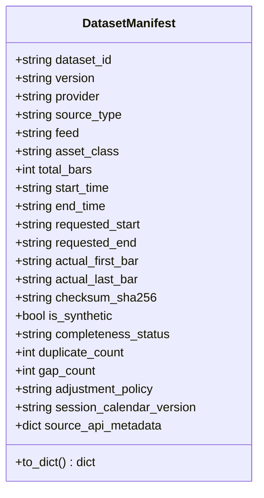

# GĐ41 — DATA PROVENANCE SPECIFICATION

## 1. Provenance Architecture
Every historical bar and dataset within AlgoTrading V2.0 carries explicit, immutable provenance metadata distinguishing real market data from synthetic fixtures and streaming backfills.

---

## 2. Source Classification Taxonomy

| Source Type | Description | Permitted Environments | Label in UI |
|---|---|---|---|
| `REAL_HISTORICAL_MARKET_DATA` | 1-minute OHLCV bars retrieved via Alpaca Market Data API (Equities & Crypto) | Simulation, Research, Paper Replay | **REAL ALPACA HISTORICAL DATA** (Emerald) |
| `NATURAL_RUNTIME` | Streaming bars ingested via Redpanda/Kafka pipeline from live publishers | Live Streaming, Paper Bot Runtime | **LIVE STREAMING** (Blue) |
| `HISTORICAL_BACKFILL` | Backfilled bars loaded from disk storage for bot warmup | Paper Bot Warmup, Pipeline Replay | **BACKFILL WARMUP** (Cyan) |
| `SYNTHETIC_FIXTURE` | Mathematically generated test fixtures | Unit Tests, Integration Tests, Demos | **SYNTHETIC FIXTURE (TESTING ONLY)** (Amber) |

---

## 3. Strict Truth-in-Reporting Rules
1. **No Silent Fallback**: If an Alpaca fetch fails (e.g. rate limit, bad dates, network down), the backend returns an explicit HTTP 4xx/5xx error. The system never silently generates synthetic bars to mask an Alpaca fetch failure.
2. **Provenance Badging**: The Backtest Dashboard strictly displays the green "REAL ALPACA HISTORICAL DATA" badge only when `source_type == "REAL_HISTORICAL_MARKET_DATA"`. When replaying synthetic fixtures, an amber "SYNTHETIC FIXTURE (TESTING ONLY)" badge is displayed.
3. **Canonical Hashing**: Every dataset computes a canonical SHA-256 checksum over the formatted bar string `symbol:event_time:open:high:low:close:volume:bar_revision`. Any modification to bar data immediately invalidates the checksum.
